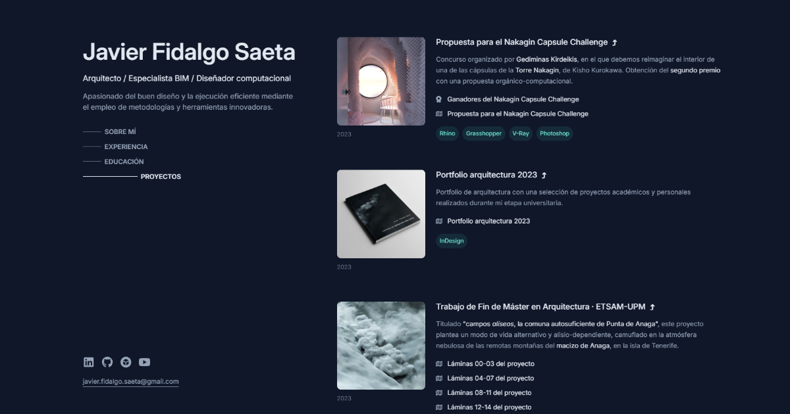

# Javier Fidalgo Saeta · Portfolio

[](https://javierfidalgosaeta.com)
[](https://pages.github.com/)

Source code of [javierfidalgosaeta.com](https://javierfidalgosaeta.com), my portfolio as an architect and BIM specialist: experience, education and projects, in Spanish and English.

[](https://javierfidalgosaeta.com)

## Features

- **No build step and no dependencies.** Hand-written HTML and CSS, with a short script that highlights the section in view in the navigation.
- **Spanish and English.** Each language has its own page, `/` and `/en/`, linked with `hreflang` so search engines index both.
- **Responsive.** On wide screens the header stays fixed beside the content and its navigation highlights the section in view; on phones the page becomes a single column.
- **Accessible.** Visible keyboard focus, labelled icon links, section titles kept for screen readers, and smooth scrolling only for visitors who have not asked for reduced motion.
- **Search and sharing metadata.** Description, Open Graph preview card, schema.org structured data, `sitemap.xml` and `robots.txt`.
- **Self-contained icons.** The few Font Awesome Free icons in use are embedded in the stylesheet as CSS masks, with no icon font or CDN.

## Project structure

```text
index.html     Spanish page (/)
en/index.html  English page (/en/)
styles.css     Styles shared by both pages
script.js      Navigation highlight shared by both pages
public/        Project images, project documents (PDF) and certificates
sitemap.xml    Both pages and every PDF, for search engines
robots.txt     Crawling rules and sitemap location
CNAME          Custom domain for GitHub Pages
AGENTS.md      Conventions for editing the site
```

## Run locally

Open `index.html` in a browser, or serve the folder to test it as it runs online:

```bash
python -m http.server 8765
```

Then visit <http://localhost:8765>. On Windows, use `py` instead of `python` if `python` opens the Microsoft Store.

## Deployment

GitHub Pages serves the `main` branch directly, so every push to `main` is published within about a minute. `CNAME` sets the custom domain.

## Editing

[AGENTS.md](AGENTS.md) describes the conventions: file names in `public/`, how translations work, the privacy checks every published document needs, and when to update the sitemap. In short, every change goes into both pages: `index.html` in Spanish and `en/index.html` in English.

## Credits

- Design reference: the portfolio of [Brittany Chiang](https://brittanychiang.com/).
- Built with the help of the [HTML+CSS course](https://www.youtube.com/watch?v=Eb3lOiukwAQ) by [James McArthur](https://github.com/jamezmca).
- Typeface: [Inter](https://rsms.me/inter/), by Rasmus Andersson, served by Google Fonts.
- Icons: [Font Awesome Free](https://fontawesome.com/), under CC BY 4.0.

## License

© 2026 Javier Fidalgo Saeta. All rights reserved: the code and the content (texts, images, project documents and certificates) may not be reused without permission. You are welcome to take ideas from the layout, as I did from Brittany Chiang's portfolio.

## Author

**Javier Fidalgo Saeta**, architect and BIM specialist: [javierfidalgosaeta.com](https://javierfidalgosaeta.com) · [LinkedIn](https://www.linkedin.com/in/javi-arch/) · [GitHub](https://github.com/javi-arch)
